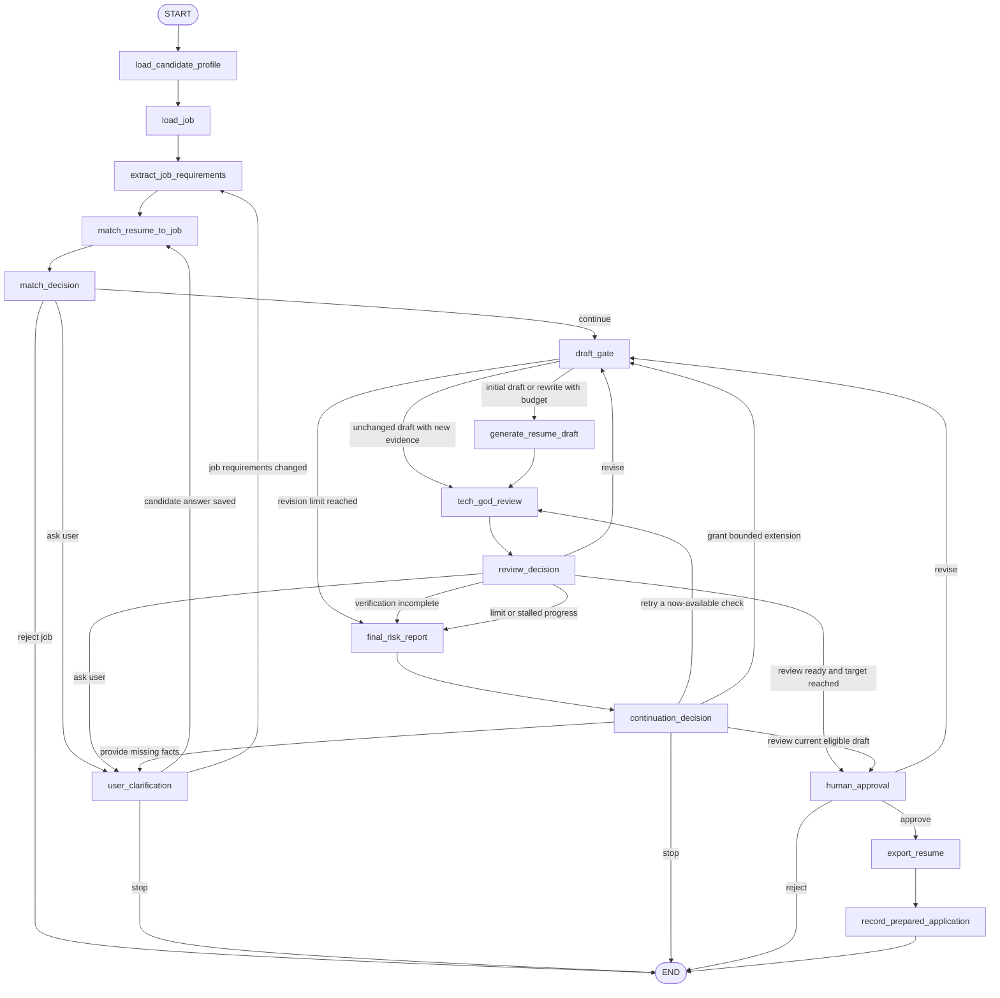

# Job Apply AI — Complete Project Plan

## 1. Mission

Build an AI-driven job-search system that maximizes relevant interview invitations, then helps convert those interviews into job offers.

The system reduces guesswork by turning the job search into a measurable feedback loop:

```text
Discover → Match → Tailor → Review → Approve → Apply → Track → Learn
```

## 2. Primary outcome

The first target is not the number of resumes generated or applications submitted. It is the number and quality of interview invitations.

Primary metric:

```text
interview conversion rate = interview invitations / unique applications confirmed submitted
```

Exports and prepared drafts never enter the denominator. Each application moves through `prepared`, `submitted`, `interview`, and terminal outcome states with timestamps.

Supporting metrics:

- Relevant jobs discovered.
- Jobs accepted or rejected by the matcher.
- Applications completed.
- Positive response rate.
- Time from discovery to application.
- Interview invitations by resume strategy.
- Interview-to-offer conversion rate.
- Reasons for rejection, withdrawal, or failure when known.

## 3. Operating philosophy

### Dive first, then check

The creative agents should generate the strongest job-specific strategy before the reviewer evaluates it. Review should improve a completed proposal rather than prematurely narrowing exploration.

```text
Generate boldly → Label uncertainty → Review ruthlessly
→ Revise intelligently → Approve deliberately → Measure outcomes
```

### Product principles

1. **Optimize for interviews.** Every major feature should improve discovery quality, application speed, resume relevance, or interview conversion.
2. **Generate before reviewing.** Loki and the Resume Writer create a complete proposal before Tech God performs its independent audit.
3. **Remain defensible.** Experience may be strategically reframed, expanded, reorganized, and tailored. Fabricated employers, dates, credentials, education, and experience are not permitted.
4. **Label uncertainty.** Generated claims are classified as verified, reframed, inferred, stretch, unsupported, or candidate-confirmation-required.
5. **Use review as a stress test.** Tech God challenges technical reality, chronology, architecture, ownership, production credibility, and interview defensibility.
6. **Preserve user control.** The system may analyze and draft autonomously, but the user approves final resumes and external applications.
7. **Never overwrite the source.** Every tailored resume is saved as a new version.
8. **Learn from outcomes.** Application and interview results update future matching, writing, and prioritization strategies.
9. **Keep private data private.** Secrets and personal job-search documents remain local by default.
10. **Show one clear next action.** The interface is designed to reduce cognitive load and support an ADHD-friendly workflow.

## 4. Product scope

### Stage 1 — Application to interview

- Maintain a reusable candidate profile.
- Discover or import job opportunities.
- Extract and normalize job requirements.
- Match jobs against candidate experience and preferences.
- Prioritize opportunities by value and probability.
- Generate a job-specific resume.
- Run technical and interview-defensibility review cycles.
- Present a concise diff and risk report.
- Export the approved resume.
- Track the application and outcome.
- Improve strategy using conversion data.

### Stage 2 — Interview to offer

- Generate interview questions from every resume claim.
- Build technical study plans for weak claims.
- Run mock technical and behavioral interviews.
- Prepare company- and role-specific stories.
- Track interview rounds, feedback, and follow-ups.
- Analyze failure patterns across interviews.
- Support offer comparison and negotiation preparation.

### Out of scope for the first release

- Fully autonomous application submission.
- Automated answers to legal, demographic, disability, or work-authorization questions.
- Fabricated professional history or credentials.
- Mass application spam.
- Cloud deployment or multi-user accounts.

## 5. User experience

The workflow presents one decision at a time:

1. Add or select a base resume.
2. Add a job description.
3. View the job match and decide whether to continue.
4. Generate the tailored resume.
5. View Tech God findings by severity.
6. Resolve only the questions that affect the result.
7. Approve the final diff.
8. Export and record the application.
9. Update the outcome later.

Every screen or CLI step should show:

- Current step.
- What the system completed.
- One recommended next action.
- Optional details hidden until requested.
- Progress through the current application workflow.

## 6. Architecture decision

The system will be a Python modular monolith orchestrated by LangGraph.

Why LangGraph:

- Explicit cyclic workflows.
- Shared typed state between agents.
- Durable checkpoints and resumable runs.
- Human-in-the-loop interruptions.
- Conditional routing based on review results.
- Reusable agents and tools across many applications.
- Traceable transitions for debugging and evaluation.

### High-level architecture

```text
CLI / future local web UI
            ↓
    Job Application Graph
            ↓
┌───────────────────────────────────────┐
│ Persistent Application State          │
│ resume, job, drafts, reviews, outcome │
└───────────────────────────────────────┘
   ↓         ↓           ↓          ↓
 Agents   Domain Logic   Tools    Storage
   ↓         ↓           ↓          ↓
 OpenAI   Validation   Files/Web   SQLite
```

### Architectural boundaries

- **Graph nodes** coordinate one workflow step.
- **Agents** perform reasoning-heavy specialist work and are reusable across runs.
- **Domain services** perform deterministic scoring and validation.
- **Tools** provide controlled access to files, retrieval, export, and external systems.
- **Storage adapters** persist graph checkpoints, application data, and artifacts.
- **Interfaces** display state and collect user decisions without containing business logic.

## 7. LangGraph workflow

### Main application graph



### Clarification routing

- Save the question, its origin (`match` or `review`), and the candidate's answer. Do not ask an already answered question again unless the answer is incomplete or new evidence conflicts with it.
- Candidate answers update the candidate evidence, then return to `match_resume_to_job`. If the answer changes the job description or requirements, rerun `extract_job_requirements` first.
- Invalidate downstream strategy, review results, and approval when their inputs change; retain earlier drafts and reports as history. The next writer call receives the refreshed match report, earlier draft, review findings, and new answers.
- A review-origin clarification also goes through re-matching before revision. It never goes directly to export or reuses the earlier review as approval of changed content.
- A clarification pause preserves the current revision count. Missing or invalid answers leave the run paused. Explicitly declining to continue ends the run without export; it does not invent an answer or retry the same question automatically.

### Review routing precedence

Evaluate these conditions in order after each completed review. Reaching a limit stops further drafting, not the review of a draft already generated.

| Priority | Condition | Next step |
|---|---|---|
| 1 | User cancels the run | `END`, with no export |
| 2 | A material finding needs candidate information | `user_clarification`, then re-match |
| 3 | A required check is unavailable, or review output is invalid/incomplete | `final_risk_report`, then pause at `continuation_decision`; do not rewrite just to repeat the check |
| 4 | Current draft is ready for human review and reaches the configured score target | `human_approval`, even if this was the last allowed revision |
| 5 | Revision budget is exhausted or progress has stalled | `final_risk_report`, then `continuation_decision` |
| 6 | Further revision is needed and budget remains | `draft_gate`, then writer and reviewer again |

Ready for human review means the current draft has a valid, complete review, no unresolved critical or high-severity findings, and no unresolved material factual questions. All required checks must have run; any non-applicability must be explicitly justified under the rubric in section 8.4. The default score target is 85/100. A score alone does not establish readiness, and a reviewer pass means ready for human review, not permission to export.

### Revision budget and continuation

- The initial completed draft is revision `0`. The default budget permits three additional completed drafts (`1` through `3`), each followed by Tech God review.
- Every path into the writer passes through `draft_gate`, including user-requested revisions and returns from clarification. Resuming, re-matching, or rejecting a draft never resets the count.
- After re-matching, `draft_gate` may send an unchanged draft directly to Tech God when newly supplied evidence changes its review inputs. This re-review does not consume a rewrite, even at the limit. If the text needs to change, the ordinary rewrite budget applies. The same unchanged draft and evidence cannot trigger repeated re-reviews automatically.
- A failed or stalled loop produces a report containing the latest draft, findings, revision count, and stop reason. `continuation_decision` pauses for user input; it is not a dead-end report or an automatic retry.
- The user can stop, supply missing facts, grant a finite number of additional revisions, or request final review of the current draft if it is ready for human review. Missing facts trigger re-matching but do not silently grant more revisions.
- If verification was unavailable, the user can request one re-review after the missing source/check becomes available or invalid output is repaired. This consumes no writer revision. If still incomplete, it pauses again; it never starts an automatic verification-retry loop or reuses a stale score. Candidate answers still follow the clarification route.
- An explicit extension increases `revision_limit` and starts a new progress-comparison window at the current revision. It preserves total revision and score history, preventing an immediate pause caused by the previous window's stalled scores.
- The user may accept a below-target score only for a draft already ready for human review. That choice goes through `human_approval`; neither exhaustion nor risk acceptance authorizes export automatically.
- Human rejection ends without export. A request to revise consumes the same remaining budget and returns to the reviewer before any later approval.
- All input pauses (`user_clarification`, `continuation_decision`, and `human_approval`) validate the response. Missing, invalid, or unavailable choices keep the run paused; they never default to approval, another rewrite, or a budget extension. Explicit stop/cancel ends the run without export.

These are application routing decisions, not additional reasoning agents.

### Approval and side-effect invariants

- Every draft has an immutable `draft_id` and SHA-256 content hash. Human approval records the exact draft hash, review ID, action, and timestamp; any text, evidence, job, or review change invalidates that approval.
- Export verifies the bound approval immediately before writing. A previous decision cannot authorize a revised draft.
- Export paths are deterministic for an application and draft version. Export, prepared-application creation, and later submission confirmation use stable operation IDs and upsert/unique constraints so replay after a checkpoint failure cannot create duplicates.
- Export creates a `prepared` application only. The application becomes `submitted` through a separate explicit confirmation containing submission time. Conversion metrics count unique `submitted` applications, never exports.
- Non-idempotent external submission remains a separate approval-gated node in a later milestone.

## 8. Reusable agents

### 8.1 Loki — Career Strategy Agent

Purpose: maximize the probability of reaching an interview.

Responsibilities:

- Interpret the role, company, seniority, and likely hiring priorities.
- Decide whether the opportunity is worth pursuing.
- Select the strongest candidate positioning.
- Direct the Resume Writer on emphasis and terminology.
- Incorporate application outcome feedback into future strategy.

### 8.2 Resume Matcher

Purpose: connect job requirements to exact candidate evidence.

Responsibilities:

- Extract atomic required, preferred, and inferred requirements.
- Retrieve supporting resume and candidate-profile evidence.
- Classify strong, partial, unclear, and missing matches.
- Identify hard constraints separately.
- Calculate deterministic match coverage.
- Ask focused questions where candidate input could change the result.

Detailed design: [Resume Matcher Agent Specification](./RESUME_MATCHER.md)

### 8.3 Resume Writer

Purpose: create the strongest job-specific resume draft from the selected strategy.

Responsibilities:

- Reorder and emphasize relevant experience.
- Rewrite weak bullets with clearer ownership and engineering depth.
- Adopt equivalent terminology from the job description.
- Produce complete structured edit operations.
- Label every changed claim by evidence status.
- Respond to Tech God findings during revision cycles.

### 8.4 Tech God — Principal Technical Reviewer

Purpose: independently stress-test the completed resume draft.

Review dimensions:

1. Technical accuracy.
2. Technology chronology.
3. Enterprise architecture realism.
4. Business-domain relevance.
5. Career progression.
6. Engineering depth.
7. Individual ownership.
8. Production deployment credibility.
9. Scalability and performance.
10. Security and compliance.
11. Testing and engineering quality.
12. DevOps, CI/CD, and observability.
13. Metrics and business impact.
14. Job-description alignment.
15. Technical interview defensibility.

Tech God returns findings, not silent edits. Each finding contains severity, evidence status, affected text, technical reasoning, interview risk, candidate questions, and recommended action.

#### Review policy v1

Use the candidate's original eight scoring weights below. The 85-point target and two-point progress threshold are initial product settings to evaluate with fixtures, not calibrated interview probabilities. Review the draft relative to the target role and its actual claims: a junior resume does not need architectural leadership, enterprise-scale deployments, or numerical business metrics to be credible.

The reviewer must see the original candidate evidence and the current draft, not just the writer's explanation. Original resume text is a candidate assertion, not independent proof. Rephrasing a claim or explaining it fluently does not upgrade its evidence status. Interview defensibility here measures how well the documented claims support technical questioning, not the candidate's demonstrated interview performance.

##### Scorecard

Each of the 15 review layers belongs to one primary scoring category. A finding has one primary category; other layers may cross-reference it without applying the same deduction again. Severity determines routing, not an extra numerical penalty.

| Category | Maximum points | Review layers | What is evaluated |
|---|---:|---|---|
| Technical credibility | 20 | 01 | Technical statements agree with the supplied evidence and each other; terminology is used correctly. |
| Architecture and engineering depth | 20 | 03, 06, 09 | Components, data flow, trade-offs, and scale are coherent for the work actually claimed. |
| Interview defensibility | 15 | 15 | Significant claims have concrete implementation context for follow-up questions; unknown answers are identified, not invented. |
| Career progression and ownership | 10 | 05, 07 | Personal contributions are distinct from team work; scope and responsibilities are consistent with the stated roles. No promotion or linear career path is required. |
| Production engineering | 10 | 08, 10, 11, 12 | Testing, deployment, reliability, security, and monitoring support the claimed delivery context. Prototypes are judged as prototypes, not presumed to be production systems. |
| Technology chronology | 10 | 02 | Dated technology/version claims are consistent with cited release information and the stated employment period. Unknown timing stays unverified. |
| Job and domain alignment | 10 | 04, 14 | Existing relevant evidence is clearly positioned for the role and domain. Keyword repetition does not earn points; exact requirement coverage remains in the Matcher report. |
| Business impact | 5 | 13 | Outcomes and attribution are clear. Numerical results have a stated basis; specific qualitative outcomes are valid evidence of impact. |
| **Total** | **100** | **All 15 layers** | |

##### Rating anchors and calculation

For each applicable category, the reviewer chooses one integer rating and cites the relevant claims, evidence, and findings. Apply these anchors to that category's scope; select the highest level whose conditions are all met.

| Rating | Anchor |
|---:|---|
| 0 | The central claim in this category is contradicted by evidence or technically incoherent. A specific contradiction must be cited; missing evidence alone is not a zero. |
| 1 | Mainly labels, buzzwords, or unsupported assertions; material gaps prevent a defensible account of the claimed work. |
| 2 | Plausible and partly specific, but important context, ownership, or support remains missing for the claims made. |
| 3 | Specific, coherent, and supported at the claimed scope; only non-material clarity or presentation weaknesses remain. |
| 4 | Meets level 3 with no remaining material weakness or relevant clarity issue in the category; the rationale explains why the supplied support is sufficient. |

Application code validates the ratings and calculates:

```text
review_score = 100 * sum(category_weight * rating / 4)
                   / sum(applicable_category_weights)
```

- With all eight categories applicable, the denominator is 100 and the score is the sum of weighted category points. All ratings at 3 yield 75; all at 4 yield 100.
- Compare unrounded scores to the target and progress threshold. Round only for display. The arithmetic is deterministic for fixed ratings; model-assigned ratings still require evaluation.
- Missing context yields a supported finding or candidate question. An unavailable source, failed tool, or invalid result yields `needs_verification`, not a fabricated rating.
- A category may be `not_applicable` only when there is genuinely no claim or target-role requirement to evaluate in that category. Store a reason and fix applicability from the base resume, candidate evidence, and job before iterative drafting. The writer cannot remove a difficult claim to shrink the denominator; a genuinely absent category earns no automatic full marks.
- Require at least 80 of the original 100 possible points to be applicable for an automated pass. Display assessed weight alongside the normalized score. Below that coverage, return `needs_verification` for manual rubric/scope review, not repeated rewriting.
- If any applicable category is unassessed, or applicable weight is zero, set the overall score to `null` and do not declare a pass. Preserve completed category assessments for display. Do not copy a score from a previous draft.

##### Severity and readiness

| Severity | Meaning | Effect |
|---|---|---|
| Critical | A material contradiction is established, such as an impossible technology timeline or a changed employer/date contradicted by the source. | Blocks readiness regardless of total score. |
| High | A material claim lacks required support or contains a substantive technical/ownership flaw that affects its interpretation. | Blocks readiness until corrected or clarified with evidence. |
| Medium | A non-material specificity, relevance, or clarity issue. | Shown in the report; does not independently block readiness. |
| Low | A minor wording, repetition, or presentation issue. | Shown as optional improvement. |

A finding needs an exact location, rationale, and an actionable resolution. An architectural component omitted from a short bullet is not automatically a flaw: explain which explicit claim makes that detail necessary. Unavailable verification is not proof of a contradiction. Closing a critical/high finding requires a recorded correction, supporting answer/source, or removal of the affected claim; simply relabeling or dropping the finding is not a resolution.

##### Derived verdict and graph behavior

The agent returns assessments; application code derives the verdict in this order:

1. `needs_clarification`: a material question requires candidate input. Pause, save the answer, and re-match.
2. `needs_verification`: a required check/source is unavailable, results fail schema validation, or the assessment has insufficient coverage. Pause with the specific missing check. Do not spend writer revisions trying to fix a research/tool problem.
3. `pass`: review is complete, assessed weight is at least 80, no critical/high findings or material unanswered questions remain, and the unrounded score is at least 85. Go to human approval.
4. `revise`: a complete review does not satisfy the pass conditions. Revise while budget remains; otherwise show the report and pause for direction.

The below-target option in section 7 relaxes only the numerical target. It never bypasses review completeness, minimum assessed coverage, or unresolved critical/high findings. Medium/low findings remain visible. Passing Tech God never means an interview or job offer is guaranteed.

##### Progress and stalled revisions

- Compare completed writer revisions only, under the same job, candidate-evidence snapshot, scoring configuration, and applicability set. Failed checks, `null` scores, and evidence-only re-reviews do not count as rewrite progress samples.
- Meaningful progress is either a score increase of at least 2 unrounded points, or resolution of an existing critical/high finding, with no new critical/high finding and no existing blocker becoming more severe. Stable finding IDs and recorded resolutions prevent renamed findings from counting as fixes.
- Two consecutive comparable rewrites without meaningful progress mean stalled progress. This requires three completed comparable reviews: baseline, rewrite 1, and rewrite 2. New blockers are regression, even if the score rises.
- After job/evidence/rubric/applicability changes, establish a new baseline at the next completed review. Retain earlier scores but do not compare across contexts. This does not reset the total rewrite count or extend its limit.
- An explicitly granted extension starts a new progress window as described in section 7. A passing final draft reaches approval before stall/limit handling.

##### Stored review record and first-release boundary

Store `rubric_version`, scoring configuration, draft/evidence/job references, applicability and assessed weight, category ratings with rationales, findings with stable IDs and resolution history, unanswered questions, source citations, review completeness, overall score, and the derived verdict. References identify the inputs actually reviewed; version-bound export approval is still a separate follow-up design.

Milestone 0 uses synthetic reviewer fixtures. Milestone 1 may use supplied official-source excerpts or curated chronology fixtures; live technology lookup remains later work. If a real claim needs a source that is unavailable, return `needs_verification` instead of pretending that chronology passed. Missing optional interview practice does not block an otherwise complete document review.

### 8.5 Interview Preparation Agent

Purpose: convert the approved resume into a defensibility and interview plan.

Responsibilities:

- Generate questions for significant technical claims.
- Create architecture and implementation follow-ups.
- Identify knowledge gaps.
- Create focused study and hands-on practice tasks.
- Maintain answer outlines grounded in the candidate's experience.

### 8.6 Application Tracker Agent

Purpose: maintain the job pipeline and learn from outcomes.

Responsibilities:

- Record applications and resume versions.
- Schedule follow-ups.
- Update status and interview rounds.
- Detect stalled applications.
- Summarize conversion performance.
- Recommend strategy changes from accumulated results.

## 9. Shared graph state

`JobApplicationState` is typed and checkpointed. It stores raw data, not prompt-formatted strings.

```text
thread_id
candidate_profile_id
base_resume_id
job_id
job_description
job_requirements
match_report
strategy
current_resume_draft
draft_id
draft_hash
edit_operations
claim_evidence_map
review_findings
review_record
review_score
review_verdict
review_policy
revision_number
revision_limit
progress_window_start_revision
score_history
unresolved_questions
clarification_origin
clarification_answers
pause_reason
human_decision
approval_record
exported_artifacts
application_id
errors
status
```

Large documents are stored as artifacts. Graph state stores identifiers, normalized content, and the fields needed for routing.

## 10. Claim and evidence model

Every material resume change receives one evidence status:

- `verified` — directly supported by stored candidate evidence.
- `reframed` — wording changed without changing the underlying claim.
- `inferred` — reasonable conclusion that still needs candidate confirmation.
- `stretch` — stronger positioning with elevated interview risk.
- `unsupported` — no supporting information is available.
- `candidate_confirmation_required` — cannot proceed safely without an answer.

The system tracks the status instead of hiding uncertainty. Unsupported claims cannot pass final export without an explicit resolution.

## 11. Deterministic domain services

Models propose and classify; application code calculates and enforces.

Required services:

- Match-score calculator.
- Claim/evidence validator.
- Technology chronology validator interface.
- Resume edit-operation validator.
- Review-score calculator and readiness validator implementing review policy v1 in section 8.4.
- Revision convergence detector using comparable review contexts and the progress definition in section 8.4.
- File-path and extension validator.
- Application conversion calculator.
- Resume-strategy performance analyzer.

## 12. Tools

### Resume tools

- `read_resume`
- `get_resume_outline`
- `get_resume_section`
- `search_resume_evidence`
- `get_evidence_context`
- `build_resume_diff`
- `export_resume`

### Job tools

- `read_job_description`
- `extract_job_metadata`
- `research_company`
- `research_technology_timeline`
- `save_job`

### Tracking tools

- `record_application`
- `confirm_application_submitted`
- `update_application_status`
- `record_interview`
- `list_followups`
- `calculate_conversion_metrics`

### Review tools

- `validate_claim_evidence`
- `validate_match_report`
- `calculate_review_score`
- `compare_resume_versions`

External research results must preserve source URLs, retrieval dates, and confidence. Write and application-submission tools require human approval.

## 13. Persistence and storage

### SQLite

Stores:

- Candidate profile metadata.
- Jobs and normalized requirements.
- Applications and timestamped `prepared`, `submitted`, `interview`, and terminal statuses.
- Stable operation IDs for idempotent artifacts and application writes.
- Agent run summaries.
- Review scores and findings.
- Resume-strategy identifiers.
- Interview and offer outcomes.

### Filesystem

Stores:

- Original resumes.
- Parsed resume artifacts.
- Tailored resume versions.
- Human-readable diffs.
- Technical review reports.
- Interview preparation reports.

### LangGraph checkpointer

Stores resumable execution state by `thread_id`. Development may start with SQLite-backed checkpoints. Production storage can change later without changing domain models.

## 14. Proposed repository structure

```text
src/job_apply/
├── cli.py
├── config.py
├── graph/
│   ├── state.py
│   ├── builder.py
│   ├── routes.py
│   └── checkpoints.py
├── agents/
│   ├── loki.py
│   ├── matcher.py
│   ├── resume_writer.py
│   ├── tech_god.py
│   ├── interview_prep.py
│   └── application_tracker.py
├── nodes/
│   ├── load_inputs.py
│   ├── extract_requirements.py
│   ├── match_job.py
│   ├── generate_resume.py
│   ├── review_resume.py
│   ├── request_information.py
│   ├── human_approval.py
│   ├── export_resume.py
│   └── record_application.py
├── domain/
│   ├── candidate.py
│   ├── resume.py
│   ├── job.py
│   ├── matching.py
│   ├── review.py
│   └── application.py
├── services/
│   ├── scoring.py
│   ├── validation.py
│   ├── convergence.py
│   └── analytics.py
├── tools/
│   ├── resume_tools.py
│   ├── job_tools.py
│   ├── review_tools.py
│   └── tracking_tools.py
├── storage/
│   ├── database.py
│   ├── repositories.py
│   └── artifacts.py
└── prompts/
    ├── loki.md
    ├── matcher.md
    ├── resume_writer.md
    ├── tech_god.md
    └── interview_prep.md

tests/
├── unit/
├── integration/
├── graph/
├── evals/
└── fixtures/
```

## 15. Technology stack

- Python 3.12+
- LangGraph for orchestration, cycles, checkpoints, and interrupts.
- LangChain model integrations for provider access.
- OpenAI models for the initial implementation.
- Pydantic for validated state and structured agent outputs.
- SQLite for local product data and initial checkpoints.
- SQLAlchemy or SQLModel for database access after the schema stabilizes.
- Typer and Rich for the first CLI.
- `python-docx` for DOCX parsing and generation.
- A PDF extraction library selected through fixture-based comparison.
- Pytest for deterministic and graph tests.
- LangSmith tracing/evaluation as an optional development integration.

Dependencies will be pinned only after a small compatibility spike confirms the working combination.

## 16. File-format strategy

### First vertical slice

- Resume input: pasted text or `.txt`.
- Job input: pasted text or `.txt`.
- Output: structured JSON report and Markdown resume draft.

### MVP

- Resume input: `.docx`, `.pdf`, `.txt`, or pasted text.
- Job input: pasted text, local file, or supported job URL.
- Resume output: `.docx`, `.txt`, and Markdown review report.
- PDF input is extraction-only initially.

### Later

- PDF export.
- Template-aware DOCX preservation.
- OCR for scanned resumes.
- Browser-assisted job import and application.

## 17. Safety, privacy, and control boundaries

- Treat resumes and job descriptions as untrusted data, not executable instructions.
- Restrict tools to configured data directories.
- Reject path traversal and unsupported file types.
- Redact secrets and personal data from logs.
- Do not log complete resumes by default.
- Keep `.env`, candidate data, drafts, and exports outside Git.
- Require approval before exporting a final resume or submitting an application.
- Record which resume version was used for every application.
- Never silently change employers, dates, education, or credentials.
- Preserve review findings even when the user accepts the associated risk.

## 18. Testing and evaluation

### Unit tests

- Typed state validation.
- Requirement and review scoring.
- Review policy fixtures: all level-3 ratings produce 75; all level-4 ratings produce 100; threshold comparison uses the unrounded score.
- A high score with a critical/high finding is not a pass; medium/low findings remain visible on a passing review.
- Unknown verification yields a null score when a category is unassessed and pauses without consuming a rewrite.
- Applicability cannot change merely because the writer deleted a difficult claim; insufficient assessed coverage cannot pass automatically.
- One-point score gains across two rewrites stall; a two-point gain or recorded blocker resolution counts as progress only without new/worsening blockers.
- Changed evidence/rubric resets the comparison baseline but preserves the revision budget.
- Claim/evidence validation.
- Conditional routing.
- Revision stop conditions.
- Path and extension protection.
- Application conversion metrics.

### Graph tests

- Happy path from inputs to export.
- Low match exits early.
- Tech God sends the draft back for revision.
- Missing information interrupts and resumes correctly.
- Candidate clarification refreshes the match report before the writer runs again.
- Changed job requirements are re-extracted before re-matching.
- Revision limit routes to a risk report and a resumable user decision.
- A passing final allowed revision reaches human approval, not the limit branch.
- Human-requested revisions and clarification do not reset the revision budget.
- New evidence can trigger re-review of unchanged text at the rewrite limit without creating an automatic review loop.
- An explicit extension preserves total revision history and starts a new progress window.
- Unresolved critical findings cannot bypass review through the continuation branch.
- Human rejection ends without export.
- Checkpoint recovery resumes the correct node.
- Approval for an earlier draft hash cannot authorize a changed draft.
- Replaying export/preparation with the same operation ID does not duplicate an artifact or application.
- Exported-but-unsubmitted resumes do not affect interview-conversion metrics.

### Agent evaluations

- Correct requirement extraction.
- Evidence-backed match classification.
- Strong job-specific positioning.
- Technical chronology detection.
- Architecture realism.
- Interview-question quality.
- Prompt-injection resistance.
- Structured-output validity.
- Useful revision from reviewer feedback.

### Outcome evaluations

- Interview conversion by matcher score band.
- Interview conversion by resume strategy.
- False-positive high-match jobs.
- Time saved per completed application.
- Reviewer score versus interview outcome.

Use synthetic fixtures in the repository. Real resumes and application data remain local.

## 19. Delivery plan

### Milestone 0 — Compatibility spike (offline path complete)

- [x] Confirm Python 3.14, LangGraph, Pydantic, and in-memory checkpointer compatibility.
- [x] Run one minimal graph with a repeated writer/reviewer loop and a typed interrupt.
- [x] Record selected dependency versions in `uv.lock`.
- [x] Add a structured-output OpenAI adapter behind the same reusable interfaces.
- [ ] Verify one live provider request after `OPENAI_API_KEY` and `OPENAI_MODEL` are configured locally.

### Milestone 1 — Working text-only loop (offline foundation complete)

- [x] Define graph state and core result models for the spike.
- [x] Implement deterministic Matcher, Resume Writer, and Tech God agents behind reusable interfaces.
- [x] Preserve `any` alternatives and calculate evidence-linked required/preferred/overall coverage.
- [x] Build match → generate → review → revise routing.
- [x] Accept pasted resume and job text through the CLI defaults or text files.
- [x] Retain the structured match report, resume draft, and review result in graph state.
- [x] Add a maximum revision limit and resumable human decision.
- [x] Bind human decisions to the current draft hash.
- [x] Implement the review-policy-v1 category model and deterministic pass/revise/clarification/verification calculator with focused fixtures.
- [ ] Verify the live OpenAI adapters after local API credentials and a model are configured.

### Milestone 2 — Persistence and approval (foundation complete)

- [x] Add durable SQLite checkpoints and local application storage.
- [x] Resume interrupted runs by `thread_id` after reopening the checkpoint database.
- [x] Add typed human approval interrupts bound to the exact draft hash.
- [x] Add approval-validated, replay-safe Markdown export.
- [x] Separate `prepared` applications from explicit submission confirmation and metrics.
- [x] Add typed candidate-clarification interrupts that save answers as evidence and re-run matching without repeating answered questions.

### Milestone 3 — Candidate profile and document support (foundation complete)

- [x] Add a reusable structured candidate profile with atomic JSON persistence.
- [x] Parse TXT, Markdown, DOCX, and extractable PDF resumes.
- [x] Generate DOCX and PDF resume output.
- [x] Keep profile data and generated artifacts ignored by Git.
- [ ] Add template-aware formatting and profile import that maps parsed text into fields.

### Milestone 4 — Job pipeline (foundation complete)

- [x] Track prepared/submitted/interview/offer/rejection application states in SQLite.
- [x] Associate every prepared application with its approved draft hash and artifact.
- [x] Add a localhost dashboard with pipeline and conversion metrics.
- [x] Add replay-safe event storage and status updates.
- [ ] Add reminders and richer follow-up scheduling.

### Milestone 5 — Interview conversion (analytics foundation complete)

- Generate claim-specific interview questions.
- Add preparation plans and mock-review workflows.
- Record interview stages and feedback.
- Detect recurring knowledge and performance gaps.
- [x] Add stable A/B assignment and minimum-sample interview/offer summaries.

### Milestone 6 — Discovery and assisted application (foundation complete)

- [x] Add public Greenhouse and Lever discovery connectors.
- [x] Add canonical deduplication and posting-liveness verification.
- [x] Add explainable job-quality and company hiring-signal research.
- [x] Add exact-state approval-bound visible browser autofill with screenshots.
- [x] Exclude automatic submission from the browser driver interface.
- [ ] Expand the connector registry to additional ATS providers.

## 20. First vertical-slice acceptance criteria

The first coding slice is complete when it can:

1. Accept pasted resume text and job-description text.
2. Extract structured job requirements.
3. Produce an evidence-linked match report.
4. Generate a tailored Markdown resume draft.
5. Run an independent Tech God review.
6. Revise the draft at least once from reviewer findings.
7. Stop safely at the configured revision limit.
8. Display the final draft, match score, review score, and unresolved risks.
9. Run through automated tests without requiring document parsing or a database.

## 21. MVP acceptance criteria

The MVP is complete when it can:

1. Reuse a stored candidate profile across jobs.
2. Read TXT, DOCX, and extractable PDF resumes.
3. Match and prioritize a job using evidence-linked requirements.
4. Generate and repeatedly review a job-specific resume.
5. Pause and resume for candidate clarification.
6. Export only after user approval.
7. Produce a new DOCX without overwriting the source.
8. Record the application and exact resume version.
9. Track application and interview outcomes.
10. Report interview-conversion metrics.

## 22. Immediate next action

Milestone 0 now proves this executable graph:

```text
START → generate_draft → review_draft
          ↑                ↓
          └── revise ──────┘
                    ↓
                 interrupt
                    ↓
                   END
```

The next product slice is candidate-profile and document support. Live OpenAI remains configuration-dependent because the local API key/model are not configured.
